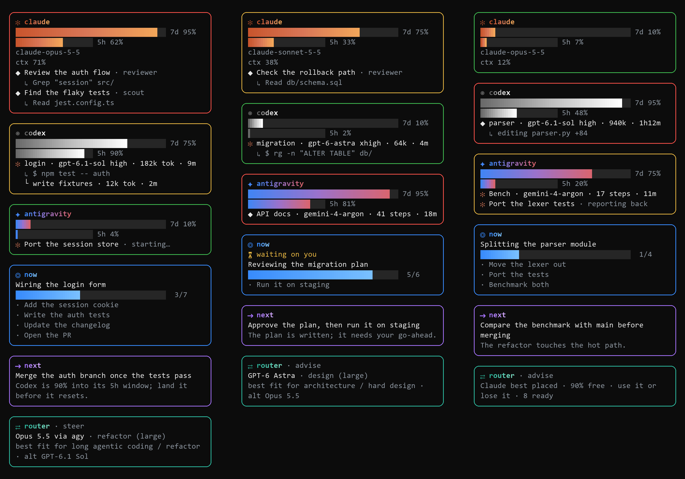

# agent-boxes

A side bar for [Claude Code](https://claude.com/claude-code) that shows, at a glance:

- **Usage meters** for Claude, and for [Codex](https://github.com/openai/codex) and Antigravity if you use them: the 7-day and 5-hour windows, with a border that turns yellow at 60% and red at 85%.
- **What every running agent is doing**: Claude's subagents and any Codex runs this chat started, each with its latest action (`↳ $ npm test`, `↳ editing app.ts`), plus any Antigravity runs this chat started (title, model, steps and elapsed time).
- **Now**: the task in progress, a progress bar, and the steps left, taken from Claude's task list.
- **Next**: a one-line recommendation for what to do after this turn.
- **Router**: who should take the task you just asked for, picked across Claude, Codex and Antigravity from public benchmarks and live quota (see [Router](#router)).



Each box's border goes green, then yellow at 60% of its 7-day window, then red at 85%. The meters are gradients in each company's colours. These are simulated examples; the side bar is 48 columns wide by default. Full size: [crunch](docs/crunch.png) · [steady](docs/steady.png) · [light](docs/light.png).

## Install

The side bar is a terminal feature and needs the fullscreen TUI.

Type this at the Claude Code prompt:

```
/plugin install agent-boxes --marketplace michaelbystryk/agent-boxes
```

Answer `y` to add the marketplace, then press Enter for the user scope. Run `/reload-plugins` to load it in the chat you're in; new chats load it on their own.

Or install it from your shell:

```sh
claude plugin marketplace add michaelbystryk/agent-boxes
claude plugin install agent-boxes@agent-boxes
```

Any other chat that's already open needs `/reload-plugins` too.

To update later, run `claude plugin update agent-boxes@agent-boxes`, then `/reload-plugins` in open chats.

### What it needs

| | |
| --- | --- |
| **Claude Code 2.1.302 or later** | Required (tested on 2.1.302). Check with `claude --version`; update with `claude update`. |
| **The fullscreen TUI** | Required for the side bar. Turn it on in `/config`, or set `"tui": "fullscreen"` in `~/.claude/settings.json`. |
| **A terminal at least 144 columns wide** | The side bar opens by itself from 144 columns, and from 110 once you've opened it with `/agent-boxes`. |
| **Python 3.8+** on `PATH` | Needed only for the Codex and Antigravity boxes. The Claude, Now and Next boxes work without it. |
| **Codex / Antigravity** | Optional. Each tool's box appears only when the tool is installed (`~/.codex` or `$CODEX_HOME`, `~/.gemini/antigravity-cli`). |

## Options

Installing asks nothing: every option starts at its default. To change one, create `~/.claude/agent-boxes/config.json` (or `$CLAUDE_CONFIG_DIR/agent-boxes/config.json`) with just the options you want, then start a new chat or run `/reload-plugins`:

```json
{ "width": 56, "background": "dock" }
```

| Option | Default | What it does |
| --- | --- | --- |
| `brief` | `true` | After each of Claude's turns, asks a small model what's under way and what to do next. Turn it off to drop the Next box and the extra model call. |
| `briefModel` | `"haiku"` | Model alias or ID used for the summaries. |
| `width` | `48` | Columns the side bar asks for. |
| `background` | `"black"` | `black` uses a black background with light text so it reads on any theme. `dock` uses the side bar's own colours. |
| `python` | `""` | Command used to run Python, such as `"py -3"` or a full path. When empty, it tries `python3`, `python`, then `py` (requiring 3.8+). |
| `router` | `"advise"` | The router's mode, or an object of [router options](#router-options). `"off"` turns it off. |

## Router

When you have Claude, Codex and Antigravity (`agy`) all at once, the router decides who should take each task. On each of your prompts, it:

1. **Sorts the request** into a category: Blender, shaders, Unity/game dev, art review, code review, bug fix, refactor, terminal, design, research, routine build, lookup, frontend or general. Keywords decide first; when none match, one short Haiku call does.
2. **Picks an executor** from that category's ranking, built from public benchmarks ([sources](docs/routing-research.md)) and weighted by live quota:
   - A pool is skipped near its limit: 5h at 90% or 7d at 95%. Claude stops earlier, at 85% / 92%, because Claude also runs this chat.
   - **Use it or lose it:** a 7-day window that resets soon with a lot unused earns a bonus. One used ahead of the clock gets a penalty.
   - Big tasks weigh quota more. Small tasks lean toward cheap executors.
   - When Claude is short, Opus and Sonnet places go to **Opus via agy**, the same model on Google's quota.
3. **Tells Claude**, in a hidden note on the prompt (press ctrl+o to see it), for example: `Suggested executor: Gemini 4 Argon, via subagent_type "agent-boxes:agy-argon". Why: best fit for hard bug fix. Fallback: Sonnet 5.5…`. A fixed routing policy in the system prompt explains the roster and the rules: delegate substantive work, do quick steps yourself, a reviewer is never the builder, and a model you name yourself always wins.

The `⇄ router` box at the bottom of the side bar shows the mode in its title. Before any routed prompt, it shows the pool best placed right now (`agy best placed · 97% free · 8 ready`). After one, it shows the pick, the category, the reason and the fallback. It drops to one line when the side bar is short.

Codex and agy quota come from the side bar's own scan, so their pools count as unknown (not empty) until Python has run it once. Sol and Astra need `codex` signed in; Argon, Flash and Opus via agy need `agy` signed in, and Argon needs an agy plan that includes it (AI Pro or Ultra).

### Executors and agents

Each executor runs as a subagent type. Your own definition wins: `~/.claude/agents/<name>.md`, then the project's `.claude/agents/<name>.md`. Without one:

- Codex and agy use this plugin's relays: `agent-boxes:codex-builder`, `codex-astra`, `agy-argon`, `agy-flash` and `agy-opus`. Each is a Haiku relay that writes the brief to a file, runs `codex exec` or `agy -p`, and reports back. A relay shows in the Codex or Antigravity box, not Claude's, with Claude's `✻` in front: first as `✻ <task> · starting…`, then as its run once the scan finds it.
- Claude's `scout`, `worker` and `architect` become `general-purpose` on Haiku, Sonnet or Opus.

The relays run `codex exec -s workspace-write` and `agy -p … --dangerously-skip-permissions`, or read-only / `--mode plan` for reviews and plans. Headless `--mode plan` lets agy open no files, so the relay pastes the files the brief names into the brief. Claude Code still asks you before each launch unless your permission rules allow it.

### Router options

`router` in `config.json` takes a mode alone (`"router": "steer"`) or an object:

```json
{ "router": { "mode": "advise", "disabled": ["flash"], "order": { "blender": ["astra", "opus"] } } }
```

| Option | Default | What it does |
| --- | --- | --- |
| `mode` | `"advise"` | `advise` adds the policy and the per-prompt note. `steer` also rewrites a spawn whose pool is out of quota to the category's best live executor, with a `⇄ worker → …` toast. Forks, resumes, teammates and workflow agents are never rewritten. `off` does nothing and hides the router box. |
| `disabled` | `[]` | Executor ids to leave out: `haiku`, `sonnet`, `opus`, `fable`, `sol`, `astra`, `argon`, `flash`, `opus-agy`. |
| `enabled` | `[]` | Executors that are off by default and that you want: `fable`. |
| `order` | `{}` | Per category id, a ranking that replaces the catalog's, by executor id. |
| `classify` | `true` | Ask a small model when no keyword matches. Turn off to label those prompts `general`. |
| `classifyModel` | `"haiku"` | Model for that call. |

`/route` prints the last pick with every candidate's score, the live quota, and any agent the roster is missing.

Claude Code's own model settings are Claude-only and blind to the task and to quota: `opusplan` switches models on plan mode, `fallbackModel` steps in on overload rather than on rate limits, and subagents take their model from their definition or `CLAUDE_CODE_SUBAGENT_MODEL`. The router leaves all of them alone and only suggests (or in `steer` mode sets) each spawn's agent type and model. If `CLAUDE_CODE_SUBAGENT_MODEL_FORCE=1` is set, Claude model picks are overridden, and `/route` says so.

## How it works

- **Claude:** usage, context and subagents come straight from Claude Code. Each subagent's `↳` line is its latest tool call.
- **Now:** reads the chat's task list from `~/.claude/tasks/<session>/` (`$CLAUDE_CONFIG_DIR` is respected across all `~/.claude` paths). With no task list, the summary model fills it in.
- **Next** and the `⏳ waiting on you` marker: one short call to the summary model after each main turn. It sends your latest request, Claude's reply (trimmed to a few thousand characters) and the task list. The call runs on your own Claude account like any other request.
- **Codex:** `scripts/boxes.py` polls every 5 seconds. It finds the `codex exec` runs this chat started by matching the chat's shell commands to Codex's local thread database in `~/.codex` (or `$CODEX_HOME`). Each run's `↳` line is the last item in its rollout log: a command, an edit or a message. Quota comes from the rate limits Codex logs.
- **Bench runs:** `python tools/bench.py run <agent> <task>` (from llm-blender-bench) starts Claude, Codex or Antigravity headless. Codex runs pair by their bench folder like any `codex exec`. Headless Antigravity leaves its database row idle mid-run, and headless `claude -p` is no subagent of the chat, so `scripts/bench_scan.py` lists those two from the run's `agent_log.jsonl` (with a `↳` latest-action line) until it ends or bench.py records it. Claude's runs show in the Claude box.
- **Antigravity:** found the same way, by matching `agy -p` runs to `~/.gemini/antigravity-cli/conversation_summaries.db`. Each run shows its title, model, steps and elapsed time (only Codex runs and Claude subagents get a `↳` latest-action line). Quota comes from `agy -p /usage --output-format json`, a read-only command that spends no quota and opens no window. It runs after an Antigravity run changes something (at most every 2 minutes), and otherwise once an hour.

Everything runs on your own machine. Nothing is sent anywhere except the summary call above.

## Troubleshooting

- **No side bar:** check the fullscreen TUI and terminal width (above). It opens by itself from 144 columns, and from 110 once you've opened it with `/agent-boxes`.
- **"needs Python 3.8+" / Python 2 / macOS `python3` asks for developer tools:** install Python 3 from [python.org](https://www.python.org) or Homebrew, or set the `python` option (see [Options](#options)) to a working Python 3.8+ interpreter.
- **Codex quota shows `–`:** stays `–` until Codex has logged at least one run in the last 7 days.
- **Codex runs don't show up:** only runs this chat started with `codex exec` are listed, and only for 12 hours after they start.
- **Antigravity quota shows `–`:** `agy` must be on `PATH` (on Windows, the default `%LOCALAPPDATA%gyingy.exe` also works) and signed in. The first reading takes a few seconds.
- **`scan slow` hint:** the 5-second background scan took longer than usual (for example, while reading large session logs or waiting on disk). It keeps the previous reading and catches up on the next poll.
- **State and cache files:** stored in `~/.claude/agent-boxes/` (or `$CLAUDE_CONFIG_DIR/agent-boxes/`). Delete that folder to clear cached Antigravity quota readings. `router-history.jsonl` there records each routed spawn (category, the suggestion, what ran) and how long it took, capped at 1000 lines; the router doesn't learn from it yet.
- **Uninstall:** run `/plugin uninstall agent-boxes` in Claude Code, or `claude plugin uninstall agent-boxes@agent-boxes` from your shell.

## Develop

```sh
git clone https://github.com/michaelbystryk/agent-boxes
cd agent-boxes
claude --plugin-dir plugins/agent-boxes      # run a chat with your working copy
claude plugin validate .                     # the marketplace
claude plugin validate plugins/agent-boxes
claude plugin test plugins/agent-boxes
(cd plugins/agent-boxes && python3 -E -m unittest tests/test_scan.py)   # the scanners' tests
python3 -E plugins/agent-boxes/scripts/boxes.py <session-id>   # the scan's raw JSON
```

In `plugins/agent-boxes/`:
- `hooks/register.tsx` is the side bar, and its hooks call the router.
- `hooks/router.ts` is the router's per-event logic.
- `hooks/route.ts` holds the classifier and balancer (pure functions).
- `hooks/catalog.ts` holds the executors and rankings.
- `agents/` holds the Codex and agy relays.
- `scripts/` holds the Codex and Antigravity scanners.

## License

MIT
